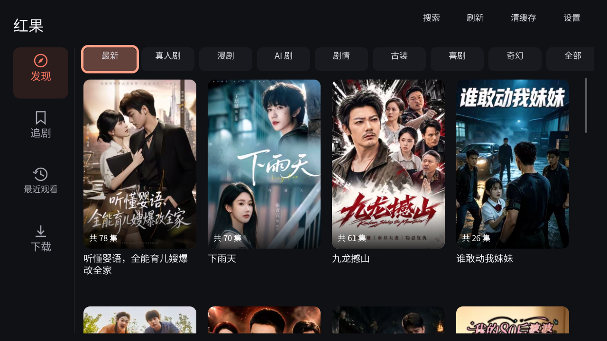
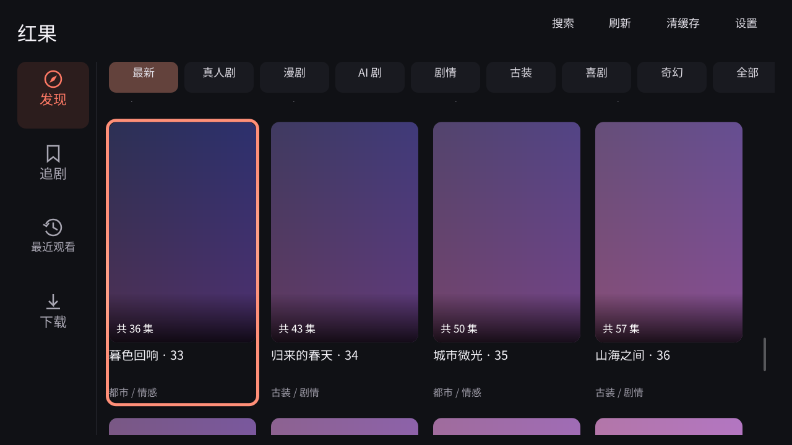
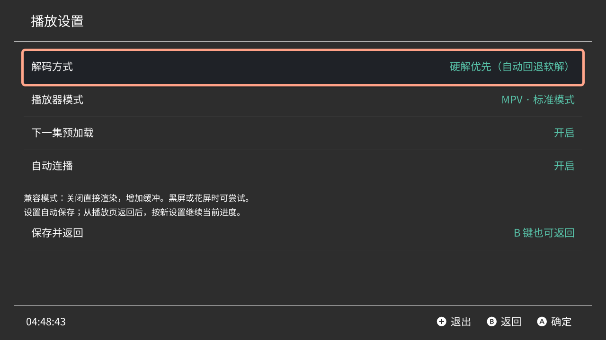

# 红果短剧 Switch 1.1.3 正式版

用户已于 2026-10-19 确认可以正式发布。安装程序与已交付的 1.1.3 测试版一致。

[下载 NSP](https://github.com/zqzhuhai-commits/hongguo-switch/releases/download/v1.1.3/Hongguo-Switch-1.1.3.nsp) · [完整安装包](https://github.com/zqzhuhai-commits/hongguo-switch/releases/download/v1.1.3/Hongguo-Switch-1.1.3-Install.zip) · [正式发布说明](https://github.com/zqzhuhai-commits/hongguo-switch/releases/tag/v1.1.3) · [全部界面截图](https://github.com/zqzhuhai-commits/hongguo-switch/releases/download/v1.1.3/Hongguo-Switch-1.1.3-UI-Screenshots.zip)

## 本版更新

- 首页和搜索结果改为滚动接近底部自动加载，保留已有短剧、焦点与滚动位置。
- 「最新」放在最前并默认选中，「全部」放在最后。切换分类或刷新返回顶部。
- 去重、防止旧请求覆盖、失败重试、到底停止加载；修复手柄下移及列表焦点，释放远处封面纹理。
- 保留封面与后续分集播放、软硬解码选择和 MPV 标准 / 兼容模式。




以上为共用原生界面的桌面截图，非 Switch 实机截屏。

首页和搜索各连续 3 页验证通过，线上目录 3 页共 54 部不同短剧；协议、原生测试、Switch 构建、4 个分集真实音视频解码、4 张 HEIC 封面及播放画面检查通过。[构建与测试](https://github.com/zqzhuhai-commits/hongguo-switch/actions/runs/39184006767) · [验证记录](dist/formal-1.1.3/verification.json)

直接安装 NSP，或将 NRO 放入 SD 卡 switch 目录并使用完整内存模式启动。Title ID 及本机配置、观看记录路径保持一致。

## 1.1.2 历史发布记录


用户已于 2026-10-18 确认 **1.1.2 实机通过**。正式版沿用已测试的程序内容，安装包与交付测试版一致。

[下载 NSP](https://github.com/zqzhuhai-commits/hongguo-switch/releases/download/v1.1.2/Hongguo-Switch-1.1.2.nsp) · [完整安装包](https://github.com/zqzhuhai-commits/hongguo-switch/releases/download/v1.1.2/Hongguo-Switch-1.1.2-Install.zip) · [正式发布说明](https://github.com/zqzhuhai-commits/hongguo-switch/releases/tag/v1.1.2) · [全部界面截图](https://github.com/zqzhuhai-commits/hongguo-switch/releases/download/v1.1.2/Hongguo-Switch-1.1.2-UI-Screenshots.zip)

## 本版功能与修复

- 修复 HEIC / WebP 封面、后续集数取流、分段解密与视频画面合成。
- 首页「设置」与播放菜单「播放设置」支持硬解优先 / 软件解码、MPV 标准 / 兼容模式、下一集预加载、自动连播；选择后自动保存，返回播放保留进度和暂停状态。
- 播放器使用异步控制，避免同步操作阻塞渲染。
- 支持分类搜索、选集、画质、倍速、横竖切换、进度拖动、下载、收藏及观看记录。

两种播放模式均使用 MPV；兼容模式关闭直接渲染并使用 32 MiB 缓冲，目前尚无第二播放器内核。所有旧 source 配置统一使用新版 Phone 适配器，无需手动改片源。




以上为与 Switch 共用的原生界面在桌面运行的截图，非实机截屏。

## 验证与安装

用户确认实机通过。自动检查通过：9 组协议 / 媒体回归、原生配置 / 策略 / 队列 / 图像检查及 Switch 构建；《首辅娇娘》第 1 / 4 / 10 / 31 集各约 15 秒、375 帧真实音视频解码，4 张 HEIC 封面，以及有 / 无播放菜单各 3/3 连续可见画面并确认帧变化。

[对应构建与测试](https://github.com/zqzhuhai-commits/hongguo-switch/actions/runs/39098142309) · [验证记录](dist/formal-1.1.2/verification.json)

直接安装 NSP，或将 NRO 放入 SD 卡 switch 目录，从完整内存模式启动。设置保存在 `switch/hongguo.cfg`，本机记录位于 `switch/hongguo-saf/`。Title ID 为 `0100F00D53414600`。内容源可用性受服务端及网络影响。

## 历史实现记录

以下保留早期版本及开发阶段的说明；其中当时的测试状态、片源切换方式与截图布局不代表当前版本，当前结果以上文和 1.1.2 发布说明为准。

## 1.0.0 正式版历史记录

[下载 NSP](https://github.com/zqzhuhai-commits/hongguo-switch/releases/download/v1.0.0/Hongguo-Switch-1.0.0.nsp) · [正式版发布说明](https://github.com/zqzhuhai-commits/hongguo-switch/releases/tag/v1.0.0)

此版本以原仓库客户端架构为基础，适配用户提供的 build158 单视频请求形式，未修改 build158 NSP 本体。用户已确认 0.1.9-test.1 可以播放且交互功能正常，并授权正式发布。本次增加 ZR 横竖屏切换快捷键、每 100 集分组选择和首页横向浏览提示；新增项目通过源码检查及原生构建，尚未由用户再次实机测试。不宣称完整复刻 build158 的原生程序。

- 首页短剧与漫剧海报栏加宽卡片，初始露出下一张封面的一部分，并显示“向右滑动 →”提示。
- 超过 100 集时，分集页顶部按“1-100 集、101-200 集……”分组；每次只创建当前组的最多 100 个按钮，实际集数、进度及自动连播不受分组影响。
- 默认优先使用 `/novel/player/video_model/v1/` 与 `video_id` 请求体，包含 build158 的 `disable_video_relate_book` 字段；支持直接返回的 `video_model`。
- 首页最顶部“一键清除视频缓存”清理播放源、视频信息和后台活动流的内存缓存，保留收藏、观看历史及目录缓存；本架构不在 SD 卡保存视频下载缓存。
- 播放中按 **ZR**，或使用播放菜单的“横竖切换”，在 0° 与 90° 间旋转视频，保持比例；L/R 仍为上一集/下一集。
- 点击或拖动进度条跳转；长按播放画面 400ms 临时 2 倍速，松开、取消、暂停或切集恢复原倍速。
- 名称为“红果短剧”，安装图标使用用户提供图片；界面按钮及操作说明为中文。
- RomFS 内置 `hongguo.cfg`，SD 卡 `switch/hongguo.cfg` 可按项目覆盖。支持 `hwdec=auto/no/nvdec/nvdec-copy`；原生客户端统一使用新版 Phone 适配器，旧 `source` 配置不再切回旧接口。

**本架构使用原仓库的 GPU OpenGL 渲染。build158 专用的 `renderer=deko3d` 不兼容，不能直接套用其渲染实现。用户已确认此适配版本能够播放；内容源不同剧集的可用性仍取决于服务端。**

Title ID 沿用仓库 `0100F00D53414600`，与上传的 build158 不同。源码许可证与来源声明沿用 LICENSE、NOTICE.md 和 licenses/。

## 首页重做

按用户提供的手机横屏参考图调整为深色、珊瑚红选中态：左侧「发现 / 追剧 / 最近观看」，顶部搜索、刷新与清缓存，横向分类栏，下方四列 2:3 圆角海报。集数叠加在封面底部，剧名和类型位于封面下方；首屏直接展示剧集。分类包括全部、最新、真人剧、漫剧、AI 剧、剧情、古装、喜剧和奇幻，均连接实际目录或搜索请求。追剧与历史复用原本机数据。

支持触摸与手柄；X 搜索（卡片获焦时 X 查看完整剧名）、Y 刷新，方向键在侧栏、分类与卡片间移动。异步加载使用请求序号防止快速切换分类后旧结果覆盖新结果，并在销毁卡片前解除导航指针。增加下载入口，支持分集按钮 X 下载、后台分段下载、进度、取消及完成后离线播放；下载使用独立读接口，不替换当前播放器。原生构建可验证编译，真实界面显示与焦点手感仍需 Switch 实机检查。

音视频实测：示例第 2 集经完整适配层读取 10,710,740 字节，FFmpeg 同时解码音轨与视频轨，15 秒 / 375 帧，退出码 0。该测试验证主机端数据和解码，不等同于 Switch 实机验收。

NSP 必须在 `scripts/probe-playback.cjs` 对当前提交生成成功报告后，使用 `scripts/package-nsp.py` 和本地密钥打包。打包密钥只在本地使用；不会生成无法安装的占位 NSP。密钥不写入仓库。

## 新版取流适配（2026-10-18）

根据用户亲测可播放的 [HongguoTV-Phone-TV-NoAds](https://github.com/qq294716498/HongguoTV-Phone-TV-NoAds/tree/c356be4d1dccc187ece42aecf88a4688ef91d67e) 重新实现 Switch 取流适配层。新版目录、详情与搜索同样优先按参考项目的 App / 网站流程处理，并保留失败回退。默认 `source=phone` 使用 7.3.5.32 App 参数、`content_type=1` / `video_platform=3` 请求，解析直接返回的 `video_list`、嵌套视频信息、Base64 备用地址与新版媒体密钥。App 失败时尝试对应集的官网公开 MP4，再尝试参考项目使用的备用解析接口，包括其 v2 加密响应。

保留手柄操作、收藏、历史、分组、画质与播放器。`source=app158` 保留旧接口兼容模式（单集失败后尝试批量接口及官网），`source=web` 保留官网优先模式。已有 SD 卡 `switch/hongguo.cfg` 会覆盖内置配置；要使用新版流程，请将其中的 `source` 改为 `phone` 或移除该项。

所有官网回退严格验证当前分集 ID，不以试看或推荐视频替代。备用接口是参考项目使用的第三方服务，其可用性受上游与网络影响；返回需要二次解析或无效媒体时拒绝播放。没有有效片源的剧集仍可能失败，不宣称全部剧集恢复。

旧版在线检查：单集接口 HTTP 200 空响应，参考 hongguoTV 批量接口返回“未知异常”。官网示例首集及第 2 集通过完整取流和不同位置的 Range 读取。JavaScript、主机端 C++ 回归通过；新增 PhoneSource 测试同时使用 Node 和 Switch Buffer/crypto 适配层验证签名、媒体密钥与 v2 响应。未完成 Switch 实机播放验证，既有 Release 安装包不包含此次修改。

## 构建

```sh
sh scripts/fetch-deps.sh
cmake -S . -B build -DPLATFORM_SWITCH=ON -DCMAKE_BUILD_TYPE=Release
cmake --build build --target package-input -j2
```

输出 NRO、ExeFS、NACP 和 RomFS。NSP 使用本地打包工具与本地密钥生成，不上传密钥。

## 回归检查

```sh
node tests/phone_source.cjs
node tests/playback_fallback.cjs
node tests/build158_source.cjs
node tests/cache_clear.cjs
node tests/adapter_refresh.cjs
node tests/media_loading.cjs
node tests/official_first_episode.cjs
g++ -std=c++17 -Inative tests/playback_touch.cpp -o /tmp/touch && /tmp/touch
g++ -std=c++17 -Inative tests/playback_policy.cpp -o /tmp/policy && /tmp/policy
g++ -std=c++17 -Inative tests/app_config.cpp -o /tmp/config && /tmp/config
```

检查通过仅证明本地逻辑和数据格式处理符合测试样例，不证明内容源在线可用。

## 1.0.0 加载与画质更新

播放器菜单增加“清晰度”，列出当前片源实际提供的兼容画质；切换保留播放位置及暂停状态。切到另一集恢复自动画质。片源没有其他档位时会显示中文提示。

正常打开复用有效播放源及已验证的视频头，HTTP 连接与 DNS 缓存复用。缓冲充足时低优先级预加载下一集；前台请求到来会中止后台网络请求。可在配置设置 `playback.prefetch=no` 关闭预加载。失败重试仍强制刷新源。实际首播速度取决于网络及服务端，尚未测量本次更新的 Switch 实机耗时。应用版本仍为 1.0.0。

新增回归：`node tests/quality_prefetch.cjs`、`tests/stream_request.cpp`、`tests/worker_priority.cpp`。

## 1.0.0 卡片排版更新

首页短剧、漫剧与分类/搜索网格统一使用圆角卡片，封面以固定 2:3 比例等比填充。封面、剧名与说明共用卡片背景；标题区域固定高度并顶端对齐，短标题与换行标题的第一行、说明文字均保持同一位置。保留 X 查看完整剧名，以及首页向右滑动提示和下一张封面的露出。应用版本保持 1.0.0。

### 播放设置（1.1.2）

首页右上角「设置」或播放器菜单「播放设置」可调整解码方式、播放器模式、下一集预加载与自动连播。每次选择自动保存到 SD 卡 `switch/hongguo.cfg`，保存失败会提示。播放中进入设置会暂停，返回后恢复进度和原先的暂停状态；只修改预加载或连播不会重新加载视频。

- 硬解优先：由 MPV 自动选择设备支持的硬解，无法使用时回退软解；桌面预览始终使用软解。
- 软件解码：CPU 解码。Switch 上的高码率视频可能需要降低清晰度。
- MPV 标准模式：16 MiB 缓冲、启用直接渲染。
- MPV 兼容模式：32 MiB 缓冲、关闭直接渲染，可用于排查黑屏或花屏。

目前只集成 MPV 内核，这两个模式不是不同播放器内核，尚未集成 VLC 等第二内核。用户已确认 1.1.2 实机通过。

## 1.1.3 列表浏览更新（待实机确认）

首页分类与搜索结果取消「下一页」，接近底部自动追加更多剧集，保留旧卡片、焦点与滚动位置。切换分类或刷新时回到顶部；「最新」排在最前并默认显示，「全部」移至最后。加载失败保留当前列表，可在底部按 A 或触摸重试；剧集按 ID 去重，返回空列表或结束标记后停止。远离屏幕的封面纹理会释放，回滚时按需加载。
